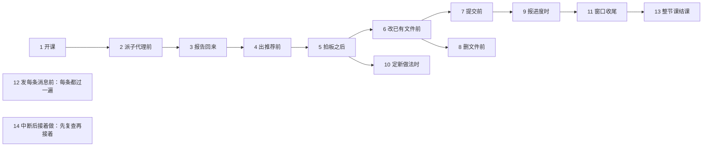

# 时刻检查单

> 去留：长期（问 533 A，DECISIONS-R1 R1-510）。原为试点（问 501 A、503 A、510 A）。第九窗口删并专场（交付物清单 D8）逐条过了一遍，70 条并删成 51 条（问 557 A，DECISIONS-R1 R1-517 到 R1-519）。
> 用途：一个窗口里每到一个时刻，先读那一张卡。每张只写要做的动作和正本在哪，不抄正文；正本改了，卡上只改指针。
> 为什么按时刻排：开头读一遍规则，撑不住整个长会话，读进来的规则会被越来越长的对话挤到中间；到那一刻再读那一张，最不容易被淹没（DECISIONS-R1 R1-487 第三、四点）。
> 两种用法：「先读再做」，动手前读完这一张再动手；「做完对一遍」，做完逐项核，在消息末尾写出来。每张卡标题后标了用哪种。
> 知识库强化 4「条件触发」与补丁 13「动手前后检查」，在本项目就落在这份文件里。原在自动记忆里的「发前自查」已搬进第 12 张卡（问 503 A）。
> 标签说的是这一条靠什么守住：【命令】有现成命令判对错，但要我记得跑；【读】只能靠读卡照做，你从消息里抽查；【你】由你把关。现在没有一条由钩子守。
> 怎么加：漏了一样，加进对应时刻那一张，写明哪次漏的；一张超过九条，先看能不能并。
> 查来历：bash scripts/decision-index.sh R1 关键词。

## 1 · 开课（先读再做）

1. 照 SESSION_START J 节七件做；本文件不另抄开课步骤（HARNESS 原则 1）。【读】

## 2 · 派角色或子代理前（先读再做）

1. 派单写清四样：第一句让它先读自己的定义文件（项目 CLAUDE.md 第一层 B 第 8 条）；写「发现冲突先指出再继续」（反模式 16）；要读的文件写死具体路径，超过五份写一句理由（规则 29；自动记忆「往后按需读文件」）；写停止条件（规则 43）。【读】
2. 一轮一件交付物，先跑短的核对轮，再跑长的起草轮（反模式 38）。【读】
3. 「规矩」块加一句：先查 docs/arch/STANDARDS.md，列适用标准、给出处、标档次（DECISIONS-R1 R1-393 第五点）。【读】
4. 派单原文、建议模型与一句理由先给你看，你说「发」才派（规则 4、规则 41）；资料管理员的固定派单除外，照 SESSION_START J 节第 2 件第二步直接派（问 569 A）。【你】

## 3 · 子代理报告回来（做完对一遍）

1. 全文从会话目录 subagents/ 下的记录取，不靠它返回的摘要；按 id 去重，核首末行、小节标题、它跑了哪些调用（反模式 39；DECISIONS-R1 R1-459、R1-470、R1-515）。【命令】
2. 抽查引文，回原文逐条核；它没核的、说不确定的，当场核或标「未核」，不在上面接着推（DECISIONS-R1 R1-459、R1-470；反模式 35 附带教训）。【读】
3. 报告当场存进仓库：体检报告照 SESSION_START J 节存 docs/LIBRARIAN_REPORT.md，别的报告存进这一步的待执行文件；存了、提交了，再在上面接着做，不只留在会话记录里（第六窗口的核对报告只在一台机器上，DECISIONS-R1 R1-527 第三点；HARNESS 原则 21）。【读】

## 4 · 出推荐、出选择题前（先读再做）

1. 先问这件事归谁拍：决策边界 D1 到 D8；口令「这里面有没有藏着一个该我拍的取舍？」（项目 CLAUDE.md 第三层 A）。【读】
2. 先搜旧裁决与项目里已有的做法：决策记录、课堂记录（docs/web_course*_sample*.md）与 book/，看有没有拍过相反的口径；推翻旧拍板的，题目里写明推翻哪条（交付物清单 G30；第七窗口漏过，DECISIONS-R1 R1-488）。【读】
3. 称「标准」要给原文出处并当场核过，没核过的标「未核」（docs/arch/STANDARDS.md；自动记忆「尽量按行业标准」）。【读】
4. 两份文件打架，照 D8 只报不改；你要推荐时，标明是应你要求给的（项目 CLAUDE.md 第三层 A D8；DECISIONS-R1 R1-390）。【读】
5. 选项给 A/B/C、推荐加一句理由，不替你拍板；每轮不超过三题，不捆题（规则 25；知识库强化 3；全局 CLAUDE.md 2.8；自动记忆「批量对照的做法」）。【读】

## 5 · 拍板之后（做完对一遍）

1. 当场落盘，不靠会话记得（规则 33 及其适用范围界定）。【读】
2. 扫传播面：五类加 HARNESS 一类，逐类写「要改」或「不影响」，打开文件核，看整行，不看截断的输出（第四窗口看截断的输出判错一处，DECISIONS-R1 R1-421 第六点）；拍的是口径或定义，再回扫它所在文件的现有条目（规则 69 及其追加）。【读】
3. 判进不进 HARNESS；判并入或新开，当场出对照（规则 77）；判新开的，再对一下 HARNESS 第五节「上次整体读」那一行，自那以后满三条就当场整体读第四节（第十七窗口查出原则 20、21、22 新开时都没对，DECISIONS-R1 R1-584）。【读】
4. 定落点与编号序列（规则 64、规则 71）。【读】
5. 记进决策记录：你的原话、未选项、理由（HARNESS 原则 12）。【读】
6. 改了某份正本（规则、反模式、手册、决策记录里的裁决），回扫检查单里指着它的卡，意思变了就跟着改（第七窗口学生提出，DECISIONS-R1 R1-494；HARNESS 原则 2）。【读】
7. 拍板里引了一份标准，查 docs/arch/STANDARDS.md 登没登：没登的同批补登；偏离了它的，同批登进「偏离登记」（第十二窗口漏登 RFC 5789，DECISIONS-R1 R1-540；第十五窗口补登数据库与 ORM，问 648 A）。【读】

## 6 · 改已有文件前（先读再做）

1. 出对照，原文用命令导出，不手打；改前 grep -c 数对照里的原文，恰好 1 次才动手（规则 28）。【命令】
2. 规则 78 管的文件要你说「帮我改」，笼统授权不算（规则 78、79）。【你】
3. 先数改动行数，过一百行先报拆法（项目 CLAUDE.md 第一层 B 第 3 条；DECISIONS-R1 问 392 A）。原样存档的材料（子代理报告、体检报告）与书章「产出物」一节收的原文不拆：先报行数，一次提交，靠 cmp 与原件逐字节核（问 619 A、653 A、699 A）。【命令】
4. 改 docs/ 或 CLAUDE.md，先报会弹几次窗、选第一项「Yes」，别选「不再问」那一项（DECISIONS-R1 R1-418 第七点、R1-514）。【读】
5. 写预期数：照要写的文字先数，不估；多行插入先存进临时文件，用 wc -l 数，再当预期（第六窗口心算错五次，DECISIONS-R1 R1-476、R1-478）。整份改后的文件先拼进会话临时目录的副本，预期在副本上用命令数；落完与副本 cmp 逐字节比，相同才算落对（第十三窗口起照做；HARNESS 原则 22）。【命令】
6. 只用 Edit 改，改的字和同意的对照一字不差；对照里的数过时，先落原样、另出对照（规则 28；DECISIONS-R1 R1-484）。【读】
7. Edit 原文的换行要算准：插入点在文件末尾时，原文带上末尾的全部换行（第七窗口漏过，DECISIONS-R1 R1-491）；删整行时，原文从本行第一个字到最后一个字，不带前后换行（第九、十一窗口各漏一次，计数闸拦下，DECISIONS-R1 R1-519、R1-535）。【读】
8. 对照里写状态与计数，按这一批全部落完之后的样子写（第六、七窗口各漏一次，DECISIONS-R1 R1-484、R1-491）；写到还没拍的题，按推荐的选项写，写明「选别的就重出」（第十三窗口漏过，R1-550）；持久文档里不写死会长的数，如编号范围、条数（第四窗口漏过，R1-423；HARNESS 原则 11）。【读】

## 7 · 提交前（做完对一遍）

1. 先跑 git status，只 add 这一处的文件（规则 63；手册第四节第 8 条）。【命令】
2. 计数比较预期，要数次数、查得出重复；不等就停，不提交（自动记忆「数对才提交」；交付物清单 G27；反模式 46）。【命令】
3. 提交信息用 Conventional Commits，如实覆盖全部改动（项目 CLAUDE.md 第一层 C 第 1 条；规则 63）。【读】

## 8 · 删文件前（先读再做）

1. 逐项核它的内容有没有第二个家，写「别处接得住（在哪）」或「先补后删」（规则 75）；核到句子一级，不只核到小节（第八窗口只核到小节，漏了一句，DECISIONS-R1 R1-508）。【读】
2. 扫谁还指着它（规则 74 事前半；HARNESS 原则 2）。【命令】
3. 列影响范围与回滚方案（决策边界 D5；知识库协议 12）。【读】
4. 你回 CONFIRM 才算，「按你推荐」不算；rm 在禁止档，删除命令由你用「! 」亲跑；删网页另有弹框，事先说（自动记忆「删东西的几道闸」）。【你】
5. 删后改目录树（规则 50）。【读】

## 9 · 报进度、说「推到以后」时（先读再做）

1. 先跑交付物清单开头的覆盖核对命令，没有输出才开口；进度从清单与产物的全部标题、占位导出，逐节标状态，不凭印象（规则 87；规则 57 第 19 项；第六窗口漏说契约第三节，DECISIONS-R1 R1-472、R1-473）。【命令】
2. 写「全部」「共 N 条」之前，打开文件数一遍（反模式 42 补案例）。【命令】
3. 说「放到结课」「回顾时再定」「放到本窗口收尾」，当场登进交付物清单第五节，不登不许说推（规则 87）；放到本窗口收尾的，状态写「待做（本窗口收尾）」（问 571 B）。【读】

## 10 · 定下一种新做法时（先读再做）

1. 先搜项目里有没有已有的做法：知识库、HARNESS、BACKLOG、自动记忆、课堂记录（DECISIONS-R1 R1-488 第三点）。【读】
2. 过三问：用到整个项目吗、进框架吗、进教科书吗（规则 57 第 20 项；第六窗口建交付物清单时三问都没过，DECISIONS-R1 R1-477）。【读】
3. 进教科书的，窗口收尾写进去：接口知识写进本节书章草稿，课程做法类的问题写进附录 H（问 491 A、515 A）。【读】

## 11 · 窗口收尾（先读再做）

1. 用到七八成主动收，不硬撑（规则 48；问 652 B 定维持七八成，不提前到六成）。【读】
2. 照交付物清单第三节 W1 到 W6 逐项做（规则 87）。【读】
3. 推送：推前扫八类敏感：邮箱、令牌、Bearer 长串、私钥头、连接串、口令赋值、机器名、家目录路径（DECISIONS-R1 R1-487 第二点；脚本在会话临时目录，丢了照八类重写，先拿造的样本自测再扫）；推后 git fetch，本机与远端差 0 和 0 才算收完；两台机器以 GitHub 上那份为准（问 553 A）。【命令】
4. 桥梁交付前过规则 45 追加五项（规则 45、规则 82）。【读】
5. 目录树最后改（规则 52）。【读】
6. 报下个窗口用什么模型与 effort（自动记忆「下个窗口用什么档」）。【读】
7. 收尾清单：没落盘的裁决、没落盘的核查结果、半截的活、新发现的问题、git status 干不干净（手册第六节）；交付物清单第五节状态写「待做（本窗口收尾）」的行逐条清：做完改「已完」写提交号，做不完的改成「待做」留在本节或移进 BACKLOG，写一句原因；清完在交付物清单里数这个标签，0 次才算收完（问 571 B；Scrum 指南：没做完的「returns to the Product Backlog」）。【命令】

## 12 · 发每条消息前（做完对一遍）

消息末尾写一行「发前自查：……过 / 不适用」，只写已经跑过的动作。某一条卡这次拦下了东西，就在这一行加写「拦下：卡 N 第 M 项」，决策记录里也记一笔；每节结课照命中数挑删除候选（规则 54，问 558 A、669 A）。来历：问 424 A（DECISIONS-R1 R1-434），你说「尽量把它变的更聪明和自适应，而不是只靠警报器」。规矩按「什么时刻做」记，不按某几个字记；只放已经漏过的类别，漏了新的就加一项，写明哪次漏的。

1. 要你回话之前：回复区照手册第四节「你可以回」，2 到 4 句照抄能回的话，每句写选了会怎样，推荐的写理由；题里不给推荐时（如 D8 题），仍写整句，每个选项一句，另加一句「要推荐」，不写「选 _」填空（第十五窗口漏过，DECISIONS-R1 R1-564）；另加安全离开一项，核 git status、没落盘的内容、git fetch 后本机与远端差几条；要先推完、两边差 0 才算能安全离开（第五窗口漏过，DECISIONS-R1 R1-432；推完才算，问 553 A）。【读】
2. 本条碰到了哪个时刻，那一张卡读了没有（问 501 A、503 A，DECISIONS-R1 R1-489）。【读】

## 13 · 整节课结课（先读再做）

1. 照规则 54 的固定动作、规则 60「结课自检」一行、交付物清单第四节 E1 到 E12 逐项做；本文件不另抄（HARNESS 原则 1）。【读】

## 14 · 一轮中断后接着做（先读再做）

1. 上一轮停在工具调用之后、没发出完整消息（你回「继续」「怎么又停了」之类），下一轮先复查那一轮动过的部分：git status；最近几次提交各改了哪些文件、几行；改过的文件与预拼副本逐字节比；待落副本依据的原文件这期间动没动；该跑的核对脚本与编号检查。结果写在消息开头，再接着发没发出的内容（你 2026-10-29 原话「每次突然中断必须重新检查相关部分，避免出错」，问 689 A；第十八窗口五次中断，DECISIONS-R1 R1-600、R1-604；反模式 48；HARNESS 原则 24）。机器整个崩过，另照附录 H 案例五第七节查：git fsck；找发出去但没有结果的调用，到磁盘上核落没落；要重做的文字从那次调用里取，不重写（第二十一窗口 WSL 中断，DECISIONS-R1 R1-640）。【读】

## 关系图

